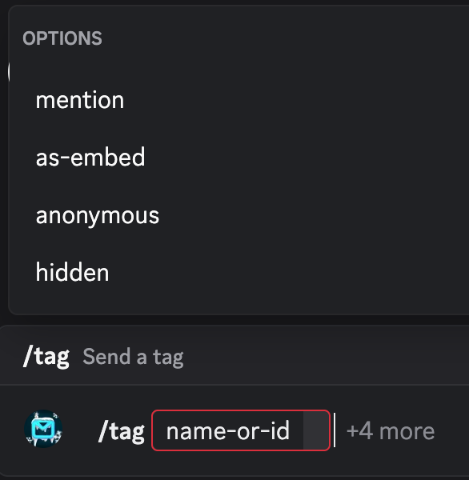

import { Tabs, TabItem, Aside } from "@astrojs/starlight/components";
import ImageWrapper from "../../../components/ImageWrapper.astro";
import DiscordMessage from "../../../components/discord/DiscordMessage.astro";
import DiscordContainer from "../../../components/discord/DiscordContainer.astro";
import DiscordText from "../../../components/discord/DiscordText.astro";
import DiscordSeparator from "../../../components/discord/DiscordSeparator.astro";
import SlashCommand from "../../../components/SlashCommand.astro";

## What are Tags?

Tags are pieces of reusable text (also known as snippets) that anyone usually can use to quickly send common responses in support tickets or chats (for example).
They help to reduce repetitive typing and ensure consistent communication.

## Managing Tags

You can manage tags in the [dashboard](https://dash.supportmail.dev/?next=tags) or with the <SlashCommand name="config tags" /> command (which has subcommands for adding, removing, and editing tags).

## Using Tags

Tags can be used in- and outside of tickets. The key difference is how they are sent.

A tag can be limited by a [rule set](/configuration/tag-rule-sets). If you lack the role or are in the wrong channel for a tag, <SlashCommand name="tag" /> tells you, and the autocomplete leaves that tag out.

You send a tag with the command <SlashCommand name="tag" /> with various options:

<ImageWrapper>
  
</ImageWrapper>

| Option       | What is does                                       | Note               |
| ------------ | -------------------------------------------------- | ------------------ |
| `name-or-id` | The name or id of the tag to send                  | Required           |
| `mention`    | Provide a user to mention when sending             | Ignored in tickets |
| `as-embed`   | Send the tag as an embed                           | Ignored in tickets |
| `anonymous`  | Send the tag anonymously                           | Tickets only       |
| `hidden`     | Send the tag as hidden (only you see the response) | In tickets, only hides the confirmation |

_This is btw also explained in the command descriptions..._

### Tags in Tickets

When sending a tag in a ticket, the tag content is sent directly to the user and it looks like a normal message from the serverteam.

This is what the user receives in their DMs:

{/* en.json: tickets.messageReceived, tickets.dmMessageMetadata */}
<DiscordMessage author="SupportMail" bot time="Today at 12:58">
  <DiscordContainer accent="success">
    <DiscordText heading="Message Received" />
    <DiscordSeparator divider={false} />
    <DiscordText>Our support hours are Monday to Friday, 9:00 to 17:00.</DiscordText>
    <DiscordSeparator />
    <DiscordText subtext>
      **Author**: @Alex ([Profile Link](https://discord.com/users/123456789012345678)) from [Example Server](https://discord.com/channels/123456789012345678) 
      **Sent at**: Today at 12:58
    </DiscordText>
  </DiscordContainer>
</DiscordMessage>

In tickets, you can also provide the `anonymous` option to send the tag without revealing your identity.

### Tags outside of Tickets

When sending a tag outside of tickets (for example in a server channel), the bot posts the tag as its reply to your command, visible to everyone in the channel.

There you can also provide the `mention`, `as-embed`, and `hidden` options to customize how the tag is sent.

<DiscordMessage author="SupportMail" bot time="Today at 13:05" command="tag" usedBy="Alex">
  <DiscordSeparator />
  <DiscordText>Our support hours are Monday to Friday, 9:00 to 17:00.</DiscordText>
</DiscordMessage>

<Tabs>

<TabItem label="With Mention">
  {/* en.json: commands.tagMention */}
  <DiscordMessage author="SupportMail" bot time="Today at 13:10" command="tag" usedBy="Alex">
    <DiscordText subtext>
      > _@Alex tagged @Sam:_
    </DiscordText>
    <DiscordSeparator />
    <DiscordText>Our support hours are Monday to Friday, 9:00 to 17:00.</DiscordText>
  </DiscordMessage>

  <Aside type="note">
    Only the selected user will be mentioned, nobody else - even though the author is visible. Their mention is just disabled.
  </Aside>
</TabItem>

<TabItem label="As Embed">
  <DiscordMessage author="SupportMail" bot time="Today at 13:10" command="tag" usedBy="Alex">
    <DiscordContainer>
      <DiscordText>Our support hours are Monday to Friday, 9:00 to 17:00.</DiscordText>
    </DiscordContainer>
  </DiscordMessage>

  <Aside type="note">
  It is still referred to as "as embed" even though they were migrated to the new Components V2 look - which still has the shape of an embed, but is not an actual Discord embed.
  </Aside>
</TabItem>

<TabItem label="Hidden">
  <DiscordMessage author="SupportMail" bot time="Today at 13:13" command="tag" usedBy="Alex" ephemeral>
    <DiscordSeparator />
    <DiscordText>Our support hours are Monday to Friday, 9:00 to 17:00.</DiscordText>
  </DiscordMessage>

  <Aside type="note">
    Fun fact: "Hidden" is actually called "ephemeral" - hidden is just a more user-friendly term for it.
  </Aside>
</TabItem>

</Tabs>

You can also mix all options together if you want...
